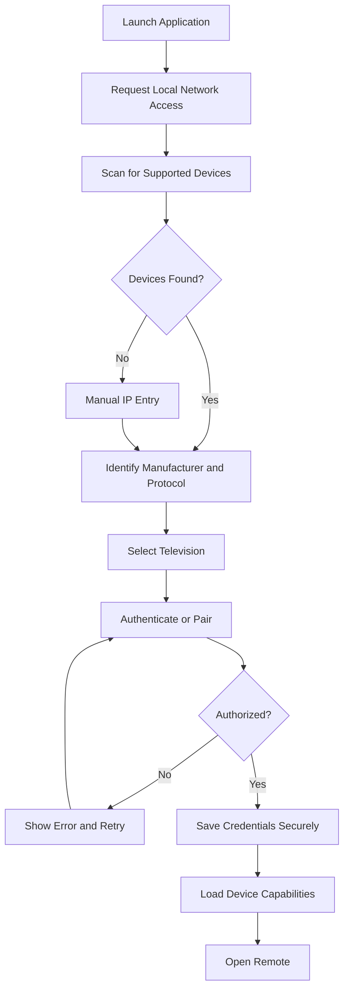

# Technical Design Document

**Universal Smart TV Remote — Free Android & iOS Application**
Version 1.0 · Product Requirements & Technical Architecture · October 2026

> This is the design the codebase implements. Implementation status per
> section is tracked in [`../README.md`](../README.md#status) and
> [`COMPATIBILITY.md`](COMPATIBILITY.md).

## 1. Executive Summary

The objective is to develop a completely free, cross-platform smart TV remote application for Android and iOS that provides a comprehensive replacement for physical television remotes.

The application will support television discovery, secure pairing, directional navigation, media playback, volume control, application launching, and, most importantly, native smartphone keyboard input for text fields displayed on the television.

The system should support multiple television manufacturers through a modular protocol architecture, rather than relying on one manufacturer's proprietary ecosystem.

The application should operate primarily over the user's local Wi-Fi network, without requiring cloud accounts, subscriptions, advertisements, or paid features.

### Primary objectives

- Free and open-source application.
- Native Android and iOS support from a shared codebase.
- Automatic discovery of compatible smart TVs.
- Manufacturer-specific pairing and authentication.
- Full-featured virtual remote control.
- Keyboard input into supported TV text fields.
- Automatic keyboard activation when supported by the TV protocol.
- Touchpad, directional pad, and gesture navigation.
- Volume, power, channel, playback, and application controls.
- Multiple saved televisions and room profiles.
- Low-latency operation and persistent pairing.
- Extensible support for new manufacturers and devices.

**Important engineering constraint:** Not every TV operating system exposes the same controls. Full keyboard integration, power-on functionality, application launching, and text-field detection must be implemented on a per-platform basis. The application must never advertise unsupported capabilities as universally available.

## 2. Target Platforms and Compatibility

| Platform | Priority | Scope |
|---|---|---|
| Android TV / Google TV | High | Android TV Remote Service integration, secure pairing, navigation, media controls, and supported text-input operations. |
| Samsung Tizen | High | WebSocket remote control, device authorization, application navigation, and model-dependent text entry. |
| LG webOS | High | webOS Second Screen integration, pointer control, keyboard input where supported, volume, and app management. |
| Roku OS | High | External Control Protocol (ECP), keypress events, supported text entry, application launching, and discovery. |
| Amazon Fire TV | Secondary | Investigate supported remote-control integrations, authorization requirements, and limitations on consumer devices. |
| Apple TV | Secondary | Evaluate protocol interoperability, authentication, and platform restrictions before committing to full support. |

Additional support can be developed for Vizio SmartCast, Hisense VIDAA, and other platforms with accessible, authorized remote-control protocols.

## 3. Application Architecture

### 3.1 Recommended technology stack

| Component | Technology |
|---|---|
| Mobile application | Flutter / Dart |
| Android | Android SDK |
| iOS | iOS SDK |
| Network discovery | mDNS, SSDP, UDP |
| Communication | TCP, WebSocket, HTTPS |
| Device persistence | SQLite |
| Credential storage | Android Keystore / iOS Keychain |
| State management | Riverpod |
| Local networking | Dart networking and native plugins |
| Testing | Flutter tests, device simulators, physical TVs |
| Licensing | Apache 2.0 or MIT |

Flutter is recommended because it supports one shared application codebase while allowing platform-specific native implementations for network discovery, keyboard interaction, haptics, and credential management.

### 3.2 System architecture

```
Flutter Application
  Remote UI · Keyboard · Touchpad · Profiles · Settings
        │
Unified Remote Controller
  Command routing · Capability checks · Connection state
        │
Device Protocol Adapter Layer
  Android TV │ Samsung │ LG webOS │ Roku │ Fire TV │ Other
        │
Local Network Transport
  Wi-Fi · TCP · WebSocket · Discovery · Authentication
        │
Paired Smart TV / Streaming Device
```

The architecture must ensure that manufacturer-specific commands never directly influence the shared UI implementation. All device-specific operations should pass through an adapter interface.

### 3.3 Unified device interface

```dart
abstract class SmartTVAdapter {
  Future<void> connect();
  Future<void> disconnect();
  Future<DeviceCapabilities> getCapabilities();
  Future<void> pair(PairingRequest request);
  Future<void> sendKey(RemoteKey key);
  Future<void> setVolume(int volume);
  Future<void> mute();
  Future<void> sendText(String text);
  Future<void> deleteText(int count);
  Future<void> launchApp(String appId);
  Future<void> movePointer(double x, double y);
  Stream<DeviceEvent> get events;
}
```

Every method must be capability-gated. Unsupported operations should return structured errors, rather than silently failing.

## 4. User Interface Design

The interface should prioritize rapid one-handed operation and minimize unnecessary navigation.

### 4.1 Main remote screen

A device header ("Living Room TV", connection state) above Remote / Keyboard / Apps tabs; the Remote tab holds power and source controls, Back/Home, a circular D-pad with a central OK button, media controls, and volume/channel rockers.

### 4.2 Additional interface features

The application should support light and dark themes, customizable button layouts, haptic feedback, left-handed mode, accessible button sizing, and an optional persistent remote shortcut.

On Android, a home-screen widget and Quick Settings tile may be supported. On iOS, widgets and shortcuts must follow platform limitations.

## 5. Keyboard Input System

This is a core differentiating feature and should receive priority during implementation.

### 5.1 Functional requirements

The keyboard subsystem must support:

- Native Android and iOS software keyboards.
- Standard text entry into compatible television fields.
- Copy-and-paste from the smartphone.
- Unicode and special characters where supported.
- Backspace, Enter, and directional keys.
- Search-field text submission.
- Password-field entry where supported and explicitly initiated.
- Hardware Bluetooth keyboards connected to the phone.
- Automatic keyboard presentation when the television reports a focused text field.
- Manual keyboard activation when automatic detection is unavailable.

### 5.2 Keyboard architecture

```
Native Mobile Keyboard      Typing · Paste · Delete · Submit
        │
Text Input Controller       Text state · Edit operations · Debouncing
        │
Protocol Text Encoder       Unicode handling · Device-specific encoding
        │
Television Text Field       Search · Browser · Login · Applications
```

### 5.3 Text input strategies

| Strategy | Description | Preference |
|---|---|---|
| Native text API | Submit text through the TV's supported input protocol | Preferred |
| Character events | Send individual characters | Fallback |
| Edit operations | Insert, replace, delete through supported APIs | Preferred when available |
| Clipboard injection | Paste through an authorized TV interface | Conditional |
| Directional keyboard | Navigate an on-screen keyboard | Last resort |

The system should negotiate the best available strategy when connecting to a device.

Text-field detection must be capability-dependent. Some television platforms expose text-editing events; others do not. A generic remote protocol cannot reliably determine whether a third-party application's text field has focus.

### 5.4 Keyboard synchronization

A dedicated state machine should handle text input:

```
DISCONNECTED → CONNECTED → TEXT_FIELD_DETECTED → KEYBOARD_ACTIVE
  → TEXT_EDITING → TEXT_SUBMITTED → KEYBOARD_CLOSED
```

The keyboard controller should distinguish between full-text replacement and incremental edits. Repeatedly sending the entire text buffer to a TV that interprets input as append-only would otherwise create duplicated characters.

For protocols that support incremental input, compute text differences and submit only required edits.

For devices without reliable synchronization, display a manual Send Text action.

### 5.5 Text input security

Passwords and sensitive information must never be written to application logs. The application must not retain text buffers after sensitive entry sessions, and it should not attempt to bypass password-entry restrictions imposed by the television or its applications.

## 6. Television Discovery and Pairing

### 6.1 Automatic discovery

Implement multiple discovery mechanisms:

- SSDP / UPnP discovery.
- mDNS / DNS-SD.
- Manufacturer-specific discovery.
- Manual IP address entry.
- Reconnection using previously saved device identifiers.

Discovery should operate only on networks the user has authorized.

Android requires the appropriate network permissions. iOS requires local-network privacy declarations and, where applicable, Bonjour service declarations or multicast entitlements.

### 6.2 Discovery process



### 6.3 Pairing security

The pairing process should use the television's native authorization mechanism, which may include PIN codes, on-screen confirmation, client certificates, or authentication tokens.

Credentials should be stored in the operating system's secure credential store. Pairing must not be bypassed, and unauthenticated commands should be avoided where secure alternatives exist.

## 7. Protocol Adapter Design

Each supported manufacturer should have its own protocol adapter package.

```
lib/
  core/
    discovery/  connection/  security/  storage/  capabilities/
  protocols/
    android_tv/  samsung_tizen/  lg_webos/  roku/  fire_tv/  apple_tv/
  features/
    remote/  keyboard/  touchpad/  applications/  devices/  settings/
  ui/
    components/  themes/
```

### 7.1 Capability negotiation

Each adapter should expose a device-specific capability object.

```json
{
  "navigation": true,
  "volume": true,
  "power_off": true,
  "power_on": false,
  "text_input": true,
  "text_field_detection": false,
  "pointer": false,
  "app_launch": true,
  "media_controls": true,
  "voice_input": false
}
```

These values are illustrative, not assertions about any particular TV model.

The UI should automatically disable or hide controls that are not supported.

### 7.2 Platform implementation notes

**Android TV / Google TV:** Investigate the current Android TV Remote Service pairing and control protocol. Avoid assuming that Android Debug Bridge (ADB) is available or appropriate for ordinary consumer remote functionality. An optional developer-mode adapter may be implemented separately.

**Samsung Tizen:** Implement supported WebSocket remote-control commands and television-side authorization. Text entry and application launching must be tested against firmware versions and model years.

**LG webOS:** Implement authorized webOS remote communication, including registration, key commands, and pointer/text APIs when available.

**Roku:** Implement SSDP discovery and the documented External Control Protocol. Confirm current ECP availability, device settings, and text-entry restrictions on each supported firmware.

**Fire TV and Apple TV:** Treat support as research milestones until the team validates a maintainable, permitted pairing and control method. Do not depend on undocumented authentication bypasses.

## 8. Full Remote Feature Set

| Feature | Requirement |
|---|---|
| D-pad navigation | Required |
| Select / OK | Required |
| Home / Back | Required |
| Power off | Where supported |
| Power on | Wake-on-LAN or device-specific support |
| Volume / Mute | Where supported |
| Channel navigation | Compatible televisions |
| Play / Pause | Required where supported |
| Rewind / Fast-forward | Where supported |
| Touchpad gestures | Compatible protocols |
| Native keyboard | High priority |
| Text-field detection | Compatible protocols |
| Application launcher | Compatible protocols |
| Input source switching | Compatible televisions |
| Voice input | Optional, platform-dependent |
| Multiple TVs | Required |
| Favorite devices | Required |
| Remote customization | Required |
| Button haptics | Required |
| Reconnection | Required |
| Offline local operation | Required |
| IR remote control | Optional Android hardware |
| Macros / button sequences | Optional |
| Accessibility / VoiceOver / TalkBack | Required |

Infrared control must be restricted to phones with compatible IR hardware or explicitly supported external accessories. Modern iPhones do not provide a general-purpose IR transmitter.

## 9. Performance Requirements

| Metric | Target |
|---|---|
| Remote command latency | Under 100 ms on healthy LAN |
| Cached-device reconnect | Under 2 seconds |
| Initial discovery | Under 5 seconds where practical |
| Button feedback | Immediate local UI response |
| Keyboard event batching | 20–75 ms configurable |
| Connection recovery | Automatic retry with backoff |
| Background battery usage | Minimal; suspend unnecessary discovery |

These are engineering targets, not guaranteed performance across every TV and network.

Long-press and repeated-key handling should be implemented using the device protocol's supported semantics to avoid runaway navigation.

## 10. Persistent Device Management

A local SQLite database should retain nonsensitive device metadata and user preferences.

```sql
CREATE TABLE devices (
    id TEXT PRIMARY KEY,
    name TEXT NOT NULL,
    manufacturer TEXT,
    model TEXT,
    protocol TEXT NOT NULL,
    ip_address TEXT,
    mac_address TEXT,
    room TEXT,
    last_connected INTEGER,
    is_favorite INTEGER DEFAULT 0
);
CREATE TABLE remote_preferences (
    device_id TEXT PRIMARY KEY,
    layout TEXT DEFAULT 'standard',
    haptics_enabled INTEGER DEFAULT 1,
    keyboard_auto_open INTEGER DEFAULT 1,
    FOREIGN KEY (device_id) REFERENCES devices(id)
);
```

Pairing tokens, certificates, and other secrets must be stored in Keychain or Keystore, not directly in SQLite.

## 11. Testing and Validation

Testing must include physical televisions, not just protocol mocks.

The test suite should cover discovery, pairing, authorization rejection, connection recovery, keyboard input, long-press behavior, text deletion, Unicode handling, application switching, and power transitions.

Particular attention should be paid to:

- Text entry in YouTube, Netflix, web browsers, and system search fields.
- Whether a TV accepts text when the on-screen keyboard is visible.
- Whether text-field focus events are exposed.
- TV sleep and wake behavior.
- Router isolation and multicast discovery restrictions.
- Firmware changes that break protocol compatibility.
- Different model years from the same manufacturer.

Automated adapter tests should use mock protocol servers, with physical-device regression tests before releases.

## 12. Implementation Roadmap

| Phase | Timing (estimated) | Scope |
|---|---|---|
| 1 — Core application | Weeks 1–2 | Flutter project, remote UI, discovery framework, SQLite storage, secure credential interfaces, and unified adapter contracts. |
| 2 — Initial TV support | Weeks 3–6 | Implement and validate Roku and LG webOS adapters, then Android TV/Google TV pairing and navigation. |
| 3 — Advanced keyboard | Weeks 7–8 | Native keyboard integration, incremental edits, supported automatic text-field detection, and Unicode regression testing. |
| 4 — Feature expansion | Weeks 9–12 | Samsung integration, touchpad support, application launcher, customization, accessibility, and reliability improvements. |
| 5 — Public release | After compatibility validation | Android and iOS builds, documentation, device compatibility matrix, security review, and store submissions. |

The schedule is a planning estimate for a focused development effort; reverse engineering, firmware differences, and physical-device testing may extend it.

## 13. Free Distribution and Licensing

The application should remain free for end users, without advertising, tracking, subscription fees, or locked premium features.

Recommended license: Apache License 2.0, which allows broad contribution and distribution while providing an explicit patent license.

Publishing is not necessarily cost-free for the developer. Apple and Google developer accounts may involve registration fees, and physical test devices will incur costs. These expenses should not be confused with charging users for the application.

Manufacturer trademarks, logos, and application icons should be used only in accordance with applicable rights and platform guidelines.

## 14. Definition of Done

The first production release is complete when a user can install the application on either Android or iOS, discover a supported television, complete authorized pairing, save that television, reconnect reliably, navigate the TV, control available media functions, and enter text into at least one verified supported TV text field using the smartphone's native keyboard.

A public compatibility matrix should identify precisely which features work on each tested TV platform and model.

## 15. Recommended Development Strategy

The most important architectural decision is to build keyboard support as a first-class subsystem rather than treating it as a simple extension of remote button presses.

The keyboard subsystem should understand each protocol's input capabilities, editing semantics, and limitations. This will prevent the most common universal-remote problem: a keyboard button that appears functional but cannot actually enter text into television applications.

For the initial MVP, prioritize Roku, LG webOS, and Android TV/Google TV, then add Samsung Tizen after validating its model-dependent authentication and text-input behavior.

Keep all protocol adapters independently testable so that future firmware updates can be handled without rebuilding the rest of the application.

The result should be a privacy-conscious, entirely local, extensible smart TV remote that provides as much of the physical remote's functionality as each television platform permits, with smartphone keyboard input as its flagship feature.
